<h1 align = "center">Echoes of The Past</h1>
<h2 align = "center">Repository for Game Development Final Project</h2>

============================================================================================
<h2 align = "center"> 4/11/2026 </h2>
============================================================================================
<h3 align = "center">Level Design Ideas & Exploration Testing</h3>

- "Added & Started Ideas for Level Design Layout with Tentative Sprites"

<h4 align = "center">Initial Look</h4>

<h4 align = "center">Video Demo</h4>

<video src="https://github.com/user-attachments/assets/d97411e6-56a8-45ec-ab39-5eb52ce8fa14" width="600"></video>

============================================================================================
<h2 align = "center"> 4/12/2026 </h2>
============================================================================================
<h3 align = "center">Introduction & Tutorial Stage with Improvisations</h3>

- Added more animations to the character
- Improved Introduction level
- Included tutorial guides and messages to help the player

<h4 align = "center">Image Sample</h4>

<h4 align = "center">Video Demo</h4>

<video src="https://github.com/user-attachments/assets/c404d3ea-c250-4fb6-8e2e-1a4af438b9ae" width="600"></video>

============================================================================================
<h2 align = "center"> 4/13/2026 </h2>
============================================================================================
<h3 align = "center">Wall sliding & Wall jumping</h3>

- "feature: improved character animations and added enhanced movements"
- Added tutorials for new character movement

<h4 align = "center">Image Sample</h4>

<h4 align = "center">Video Demo</h4>

<video src="https://github.com/user-attachments/assets/eca11570-123c-4fbc-a819-fe22afffc122" width="600"></video>

============================================================================================
<h2 align = "center"> 4/14/2026 </h2>
============================================================================================
<h3 align = "center">Dust Effect Animations</h3>

- "	feature: character animation effects"
- Added dust effects

<h4 align = "center">Image Sample</h4>

<h4 align = "center">Video Demo</h4>

<video src="https://github.com/user-attachments/assets/ef93ec58-44db-4c25-931a-f5583adbc494" width="600"></video>

============================================================================================
<h2 align = "center"> 4/19/2026 </h2>
============================================================================================
<h3 align = "center">Tutorial level Expansion</h3>

- "feature: tutorial expansion + echo/button testing"
- epxanded level design
- added title transition animation

<h4 align = "center">Image Sample</h4>

<h4 align = "center">Video Demo</h4>

<video src="https://github.com/user-attachments/assets/885a9061-4b00-4d3e-ac89-32cedd534ac6" width="600"></video>

============================================================================================
<h2 align = "center"> 4/25/2026 </h2>
============================================================================================
<h3 align = "center">Echo Mechanic Implementation</h3>

- "feature: successfully implemented echo mechanic + intro improvements"
- introduction area expansion + improvements
- added assets

<h4 align = "center">Image Sample</h4>

<h4 align = "center"> Video Demo </h4>
<video src="https://github.com/user-attachments/assets/be5ec943-f1e2-49bc-8b99-c58df5675517" width="600"></video>

===========================================================================================
<h2 align = "center"> 5/2/2026 </h2>
===========================================================================================
<h3 align = "center">Levels 1 & 2</h3>

- "update: made level designs for level 1 & 2 + save mechanics, spikes, music & sfx"
- levels 1 & 2 completions
- added music & sfx

<h4 align = "center">Image Sample</h4>

<h4 align = "center"> Video Demo </h4>
<video src="https://github.com/user-attachments/assets/0176dc1e-f00e-4860-9d59-b500e75532db"></video>

===========================================================================================
<h2 align = "center"> 5/9/2026 </h2>
===========================================================================================
<h3 align = "center">Level 3 + Boss Level</h3>

- "update: addded level 3 + boss level"

<h4 align = "center">Image Sample</h4>

<h4 align = "center"> Video Demo </h4>
<video src="https://github.com/user-attachments/assets/b61d6708-a138-4697-8688-e4235e6e52fc"></video>

===========================================================================================
<h2 align = "center"> 9/25/2026 </h2>
===========================================================================================
<h3 align = "center">Level 4: The Echo Vault</h3>

- "update: added level 4 + spike crushers, routed level 3 -> level 4 -> boss"
- Level 3's portal now leads into Level 4, and Level 4's exit portal leads to the boss
- Three puzzle sections that build on each other:
  - **The Twin Gates**: two echoes hold two pressure pads to open two gates in a row
  - **The Relay**: only one echo allowed; record it holding pad 1, then pad 2, and slip through each gate while its pad is pressed, riding elevators over a spike pit
  - **The Vault**: three echoes; one pad on the floor, one on a pillar reached by wall-jumping, one on an island in a spike pit
- Moving spike crushers over the pads add danger (echoes pass through them, the player doesn't)
- cleanup: removed the old duplicate Godot project from the repo root; `game-dev-proj/` is now the only project

<h4 align = "center">Image Sample</h4>

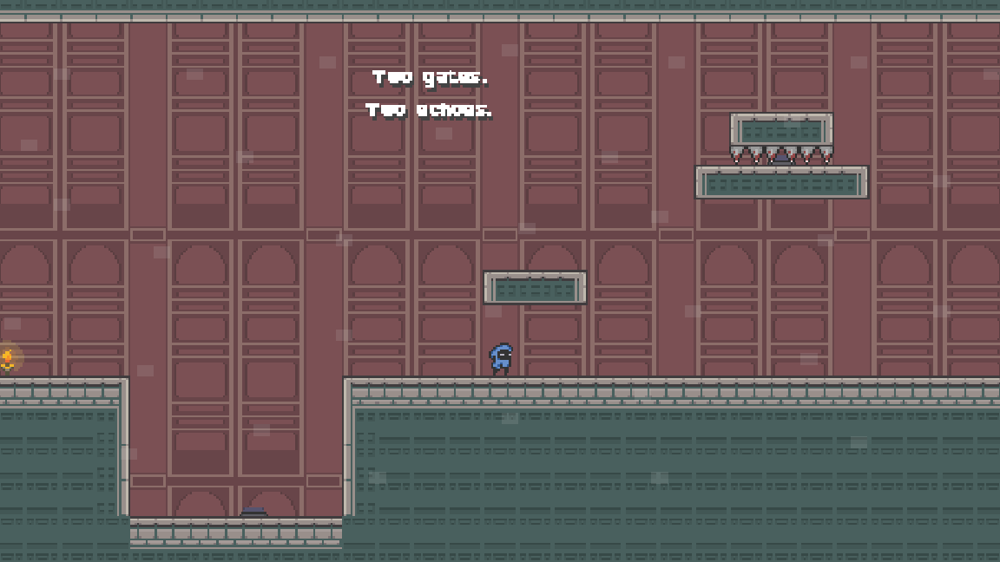
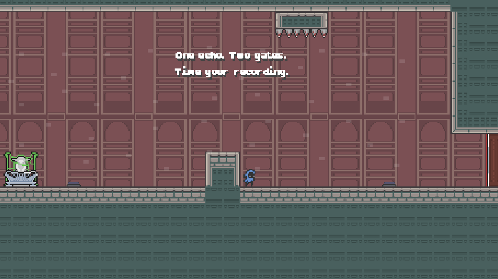
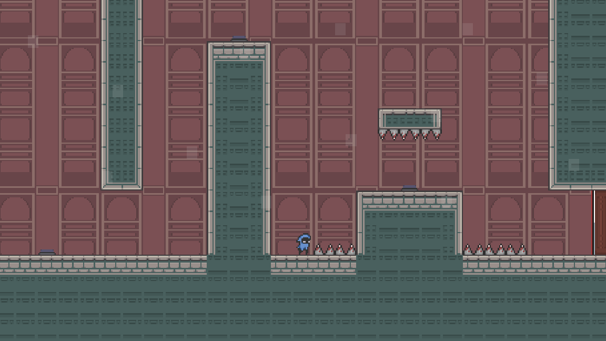

===========================================================================================
<h2 align = "center"> 10/13/2026 </h2>
===========================================================================================
<h3 align = "center">Level 5: The Undercroft</h3>

- "update: added level 5, routed level 4 -> level 5 -> boss"
- Enemies that nothing can hurt except falling spikes: lure them under ceiling spike traps and drop the spikes from a pressure pad
- Four sections:
  - **First Drop**: time a spike drop onto a patrolling rat
  - **Under the Spikes**: the button sits under the trap, so an echo has to press it
  - **The Belfry**: stepping stones over a spike pit with two traps and flying Bateyes
  - **Twin Weights**: one trap, two buttons; an echo holds one while you press the other

<h4 align = "center">Image Sample</h4>

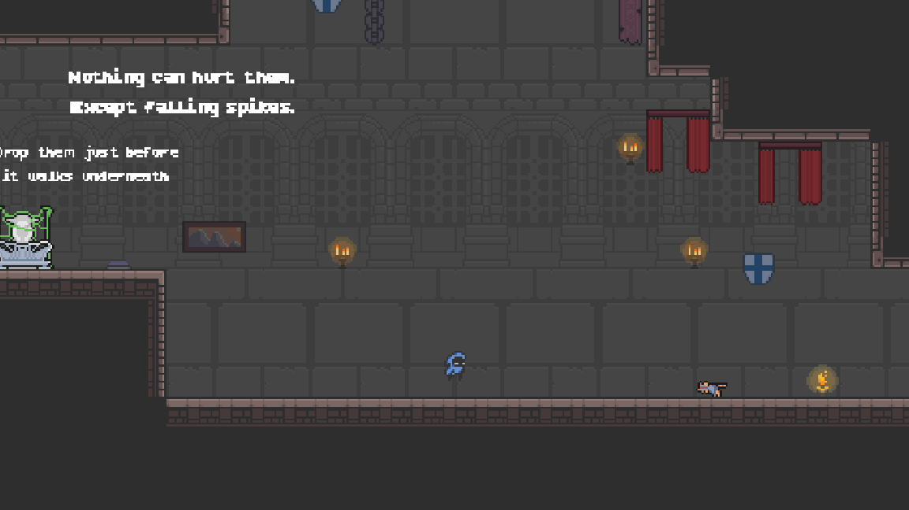
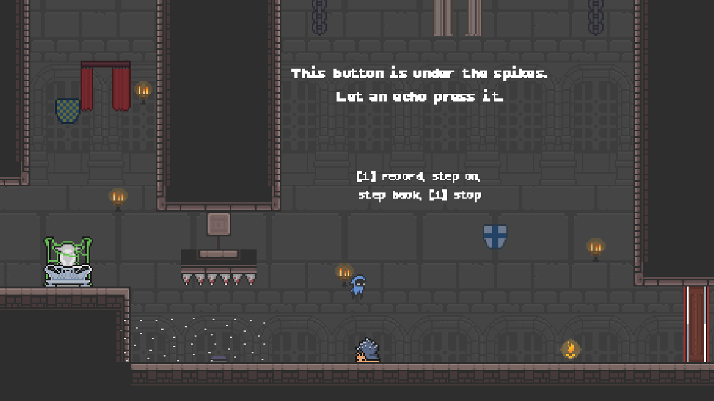
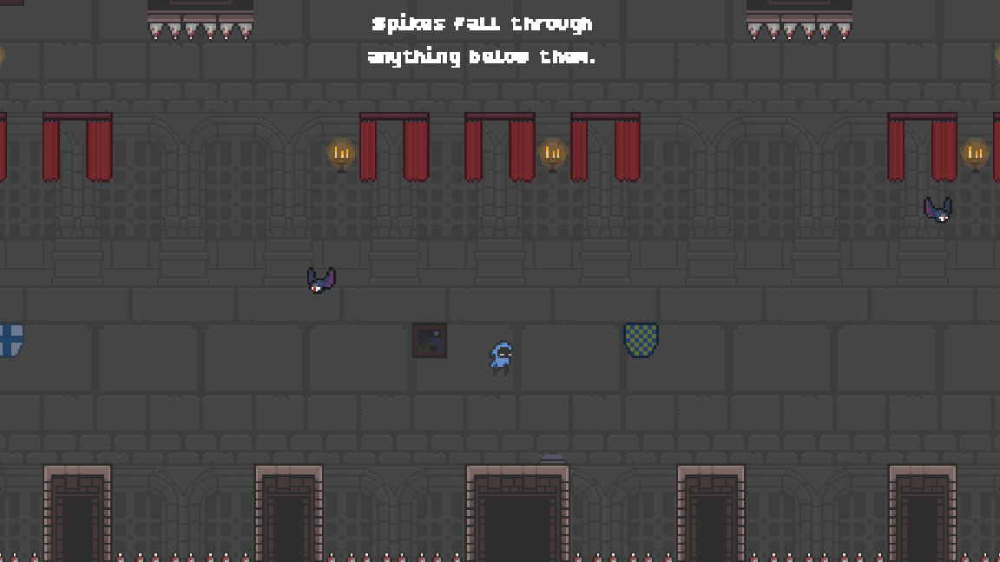
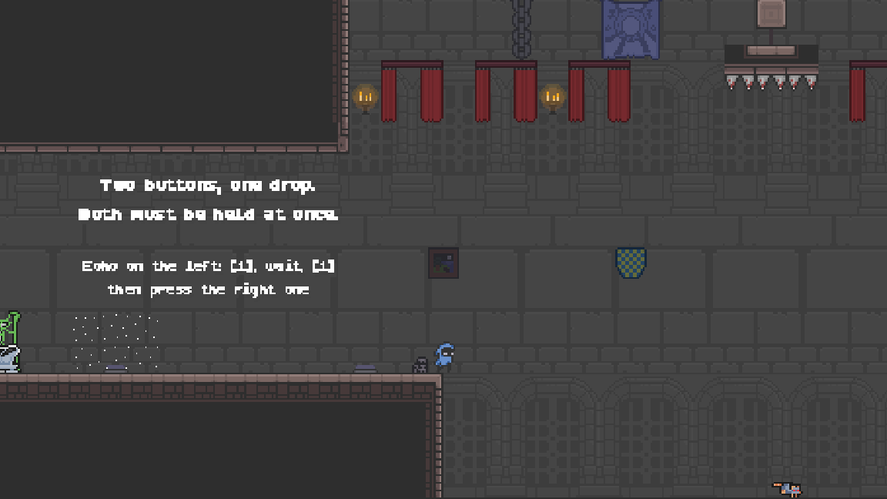

<h3 align = "center">Level 6: The Gauntlet</h3>

- "update: added level 6 after the first boss, new trap set, decorated levels 2-6"
- Beating the boss opens a portal in the arena that leads to Level 6
- A longer, harder level in the boss-room tileset, with new traps: rotating/swinging blades, rolling floor spikes, slab crushers, spear launchers and timed trapdoors
- Seven sections:
  - **Pendulum Hall**: swinging axes and a twin-blade wheel over spike pits
  - **Spike Tide**: a wave of floor spikes rolls across the room; the safe islands are in the spear launcher's line of fire
  - **Echo Relay**: three gates that stay open only while their pads are held; all three echoes needed
  - **Crusher Row**: six slabs slam down in a staggered wave
  - **The Climb**: a double-jump shaft with spinning blades and spears aimed at the ledges
  - **Slaughter Pit**: drop spike traps on the pit's enemies, one of them with an echo's help
  - **Final Gauntlet**: a blade-lined drop, timed trapdoors, moving platforms under axes and a two-echo door
- Background decor (banners, chains, paintings, shields, sconces, furniture) added to Levels 2, 3, 4 and 6
- Run a level scene on its own (F6) to start the game at that level (Levels 3-6)

<h4 align = "center">Image Sample</h4>

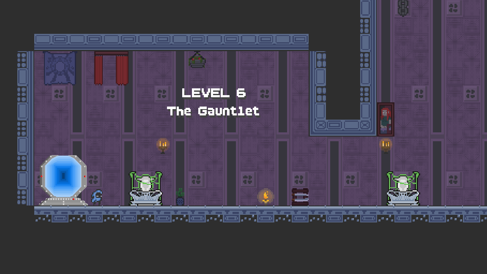
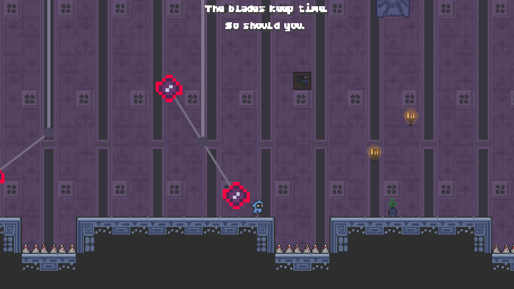
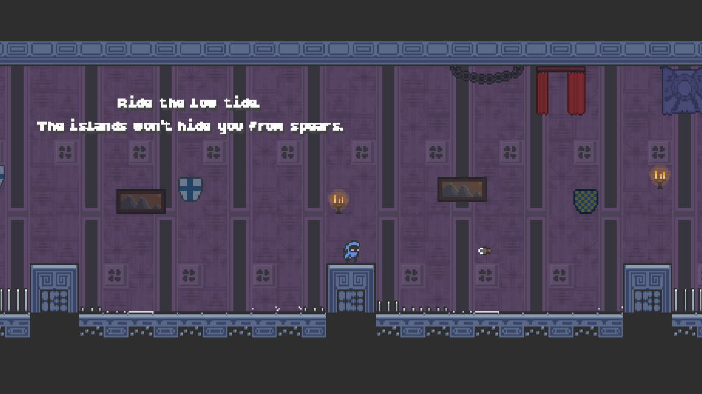
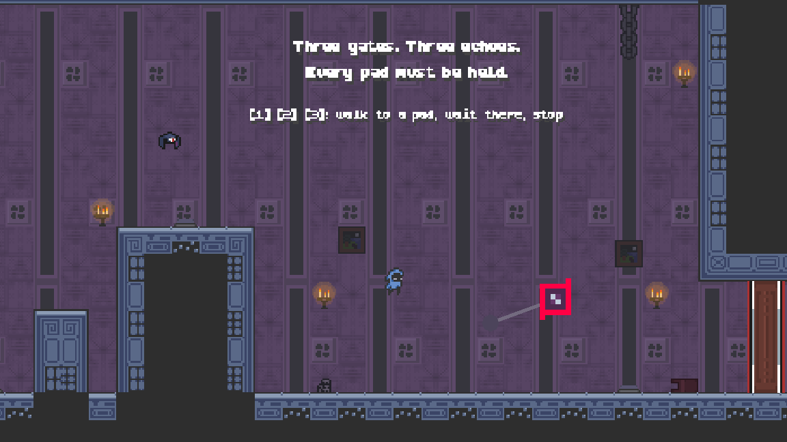
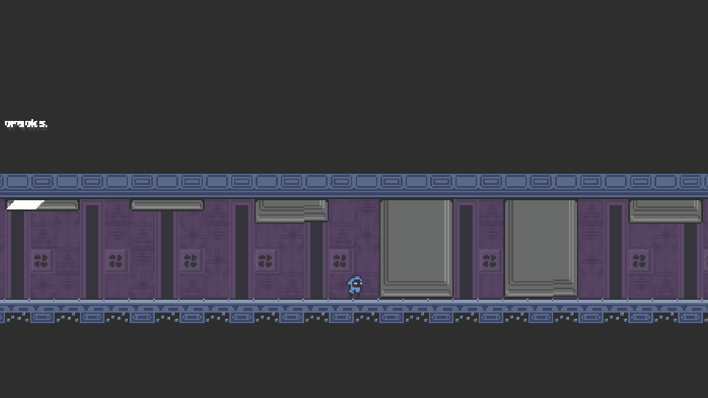
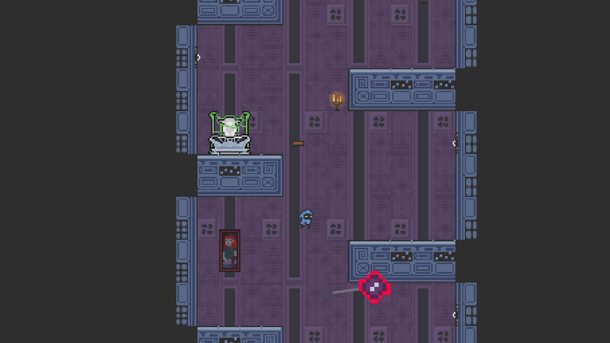
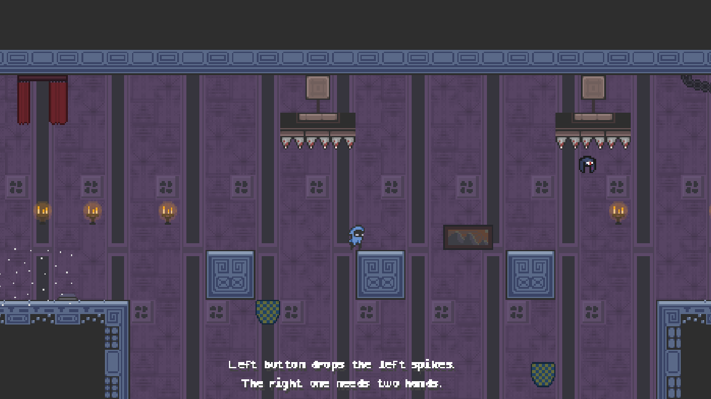
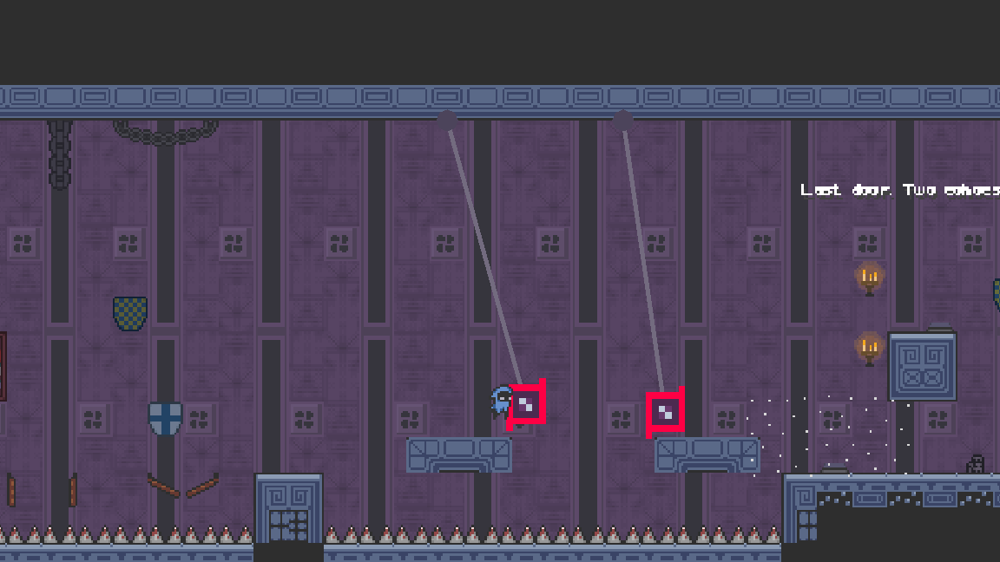
